# Relacionamentos (chaves estrangeiras)

| de | colunas | para | colunas | on delete | on update |
|---|---|---|---|---|---|
| site_private.consent_receipts | contact_request_id | site_private.contact_requests | id | CASCADE | NO ACTION |
| site_private.consent_receipts | quote_request_id | site_private.quote_requests | id | CASCADE | NO ACTION |
| site_private.customer_briefing_assets | customer_user_id | auth.users | id | CASCADE | NO ACTION |
| site_private.customer_briefing_assets | quote_request_id | site_private.quote_requests | id | CASCADE | NO ACTION |
| site_private.customer_occasion_favorites | customer_user_id | auth.users | id | CASCADE | NO ACTION |
| site_private.customer_profiles | user_id | auth.users | id | CASCADE | NO ACTION |
| site_private.customer_selections | customer_user_id | auth.users | id | CASCADE | NO ACTION |
| site_private.notification_deliveries | delivery_state_source_event_id | site_private.notification_provider_events | id | SET NULL | NO ACTION |
| site_private.notification_provider_events | delivery_id | site_private.notification_deliveries | id | CASCADE | NO ACTION |
| site_private.proposal_documents | quote_request_id | site_private.quote_requests | id | CASCADE | NO ACTION |
| site_private.quote_adjustment_requests | quote_request_id | site_private.quote_requests | id | CASCADE | NO ACTION |
| site_private.quote_adjustment_requests | requested_by | auth.users | id | CASCADE | NO ACTION |
| site_private.quote_items | quote_request_id | site_private.quote_requests | id | CASCADE | NO ACTION |
| site_private.quote_request_events | quote_request_id | site_private.quote_requests | id | CASCADE | NO ACTION |
| site_private.quote_requests | customer_user_id | auth.users | id | SET NULL | NO ACTION |

## Diagrama ER (Mermaid)

```mermaid
erDiagram
    site_private_admin_audit_log {
        bigint id PK
        text table_name
        text operation
        text row_id
        text performed_by
        text application_name
        timestamp_with_time_zone occurred_at
    }
    site_private_admin_ddl_log {
        bigint id PK
        text command_tag
        text object_type
        text schema_name
        text performed_by
        timestamp_with_time_zone occurred_at
    }
    site_private_consent_receipts {
        uuid id PK
        text request_kind
        uuid quote_request_id FK
        uuid contact_request_id FK
        text purpose
        boolean accepted
        text notice_version
        timestamp_with_time_zone client_accepted_at
        timestamp_with_time_zone server_recorded_at
    }
    site_private_contact_requests {
        uuid id PK
        text client_request_id
        text request_hash
        text source
        text status
        text contact_name
        text email
        text phone
        text page_url
        timestamp_with_time_zone client_submitted_at
        jsonb request_metadata
        timestamp_with_time_zone retention_until
        timestamp_with_time_zone created_at
        timestamp_with_time_zone updated_at
        text message
        text preferred_channel
    }
    site_private_customer_briefing_assets {
        uuid id PK
        uuid customer_user_id FK
        uuid quote_request_id FK
        text kind
        text original_name
        text storage_bucket
        text storage_path
        text mime_type
        integer size_bytes
        timestamp_with_time_zone created_at
        timestamp_with_time_zone expires_at
        timestamp_with_time_zone verified_at
    }
    site_private_customer_occasion_favorites {
        uuid customer_user_id PK
        text occasion_id PK
        timestamp_with_time_zone created_at
        timestamp_with_time_zone updated_at
    }
    site_private_customer_profiles {
        uuid user_id PK
        text verified_email
        text display_name
        text company
        timestamp_with_time_zone created_at
        timestamp_with_time_zone updated_at
    }
    site_private_customer_selections {
        uuid id PK
        uuid customer_user_id FK
        text title
        jsonb product_references
        jsonb campaign
        integer version
        timestamp_with_time_zone archived_at
        timestamp_with_time_zone created_at
        timestamp_with_time_zone updated_at
    }
    site_private_erased_customer_identities {
        text email_sha256 PK
        timestamp_with_time_zone erased_at
        integer auth_users_deleted
    }
    site_private_notification_deliveries {
        uuid id PK
        text request_kind
        uuid request_id
        text channel
        text audience
        text provider
        text provider_message_id
        text status
        smallint attempts
        text last_error_code
        timestamp_with_time_zone last_error_at
        timestamp_with_time_zone sent_at
        timestamp_with_time_zone created_at
        timestamp_with_time_zone updated_at
        timestamp_with_time_zone next_attempt_at
        uuid lease_token
        text delivery_state
        timestamp_with_time_zone delivery_state_at
        text bounce_reason
        timestamp_with_time_zone complained_at
        timestamp_with_time_zone claimed_at
        timestamp_with_time_zone lease_expires_at
        uuid delivery_state_source_event_id FK
    }
    site_private_notification_provider_events {
        uuid id PK
        text provider
        text provider_event_id
        text event_type
        uuid delivery_id FK
        timestamp_with_time_zone received_at
    }
    site_private_proposal_documents {
        uuid id PK
        uuid quote_request_id FK
        integer version
        text title
        text storage_bucket
        text storage_path
        date valid_until
        timestamp_with_time_zone published_at
        timestamp_with_time_zone superseded_at
        timestamp_with_time_zone created_at
    }
    site_private_quote_adjustment_requests {
        uuid id PK
        uuid quote_request_id FK
        uuid requested_by FK
        text client_request_id
        text message
        text status
        timestamp_with_time_zone created_at
        timestamp_with_time_zone updated_at
    }
    site_private_quote_items {
        uuid id PK
        uuid quote_request_id FK
        smallint position
        text source_product_id
        text item_key
        text product_slug
        text product_name_snapshot
        text sku_snapshot
        text image_url_snapshot
        integer quantity
        integer minimum_quantity_snapshot
        text color_name_snapshot
        text color_hex_snapshot
        timestamp_with_time_zone created_at
        text variant_id_snapshot
        text decision_group_snapshot
        uuid kit_group_id
        text kit_name_snapshot
        integer kit_quantity_snapshot
        integer units_per_kit_snapshot
    }
    site_private_quote_request_events {
        uuid id PK
        uuid quote_request_id FK
        text event_type
        text status
        text title
        text description
        text audience
        timestamp_with_time_zone created_at
        bigint sequence
    }
    site_private_quote_requests {
        uuid id PK
        text client_request_id
        text request_hash
        text source
        text status
        text contact_name
        text company
        text email
        text phone
        text city
        date desired_deadline
        text notes
        text page_url
        timestamp_with_time_zone client_submitted_at
        jsonb request_metadata
        timestamp_with_time_zone retention_until
        timestamp_with_time_zone created_at
        timestamp_with_time_zone updated_at
        uuid customer_user_id FK
        text protocol
    }
    site_private_rate_limit_buckets {
        text request_kind PK
        text identifier_hash PK
        timestamp_with_time_zone window_started_at
        integer request_count
        timestamp_with_time_zone updated_at
    }
    site_private_shared_selection_rate_limits {
        text identifier_hash PK
        timestamp_with_time_zone window_started_at
        integer request_count
        timestamp_with_time_zone updated_at
    }
    site_private_shared_selections {
        uuid token PK
        text management_token_hash
        jsonb items
        timestamp_with_time_zone expires_at
        timestamp_with_time_zone revoked_at
        timestamp_with_time_zone created_at
        timestamp_with_time_zone updated_at
    }
    site_private_status_transitions {
        text entity PK
        text from_status PK
        text to_status PK
    }
    site_private_storage_deletion_queue {
        text bucket PK
        text object_path PK
        timestamp_with_time_zone queued_at
    }
    site_private_contact_requests ||--o{ site_private_consent_receipts : "consent_receipts_contact_request_id_fkey"
    site_private_quote_requests ||--o{ site_private_consent_receipts : "consent_receipts_quote_request_id_fkey"
    auth_users ||--o{ site_private_customer_briefing_assets : "customer_briefing_assets_customer_user_id_fkey"
    site_private_quote_requests ||--o{ site_private_customer_briefing_assets : "customer_briefing_assets_quote_request_id_fkey"
    auth_users ||--o{ site_private_customer_occasion_favorites : "customer_occasion_favorites_customer_user_id_fkey"
    auth_users ||--o{ site_private_customer_profiles : "customer_profiles_user_id_fkey"
    auth_users ||--o{ site_private_customer_selections : "customer_selections_customer_user_id_fkey"
    site_private_notification_provider_events ||--o{ site_private_notification_deliveries : "notification_deliveries_delivery_state_source_event_id_fkey"
    site_private_notification_deliveries ||--o{ site_private_notification_provider_events : "notification_provider_events_delivery_id_fkey"
    site_private_quote_requests ||--o{ site_private_proposal_documents : "proposal_documents_quote_request_id_fkey"
    site_private_quote_requests ||--o{ site_private_quote_adjustment_requests : "quote_adjustment_requests_quote_request_id_fkey"
    auth_users ||--o{ site_private_quote_adjustment_requests : "quote_adjustment_requests_requested_by_fkey"
    site_private_quote_requests ||--o{ site_private_quote_items : "quote_items_quote_request_id_fkey"
    site_private_quote_requests ||--o{ site_private_quote_request_events : "quote_request_events_quote_request_id_fkey"
    auth_users ||--o{ site_private_quote_requests : "quote_requests_customer_user_id_fkey"
```

